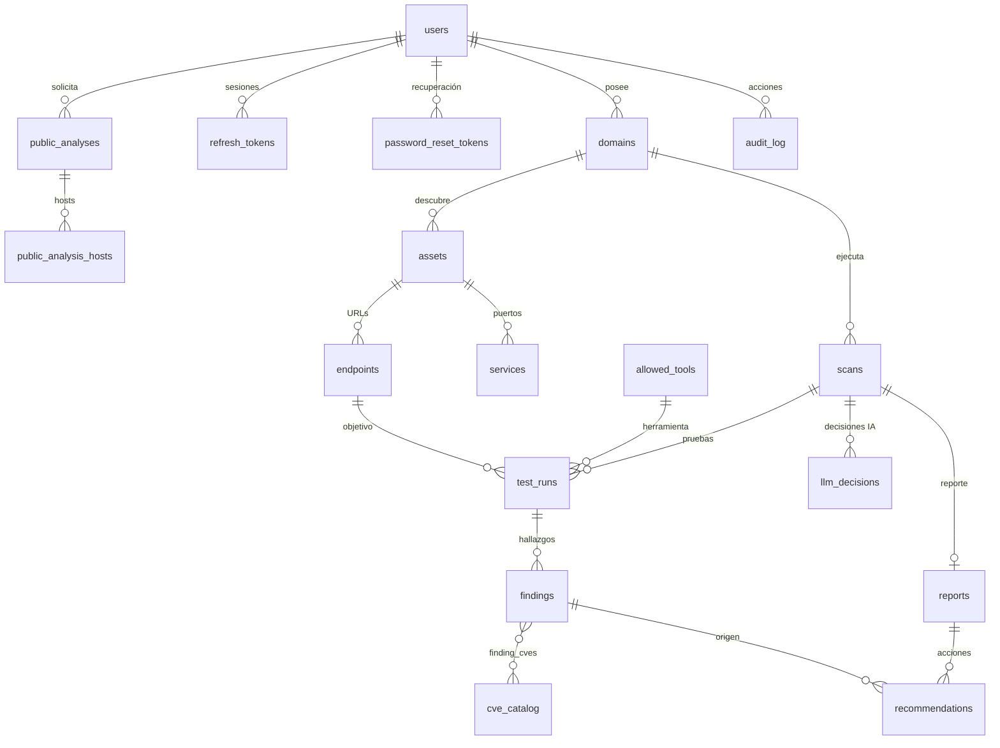

# SafeIT BD - Arquitectura

La base está organizada en seis áreas: autenticación, alcance, pruebas y hallazgos, IA y reportes, catálogo de CVE, y auditoría con análisis público. Al borrar un dominio se eliminan en cascada sus activos, escaneos, pruebas, hallazgos y reportes; `audit_log` no tiene llave foránea a dominios para conservar el historial.

## Más información

- [About](ABOUT.md)
- [README](README.md)
